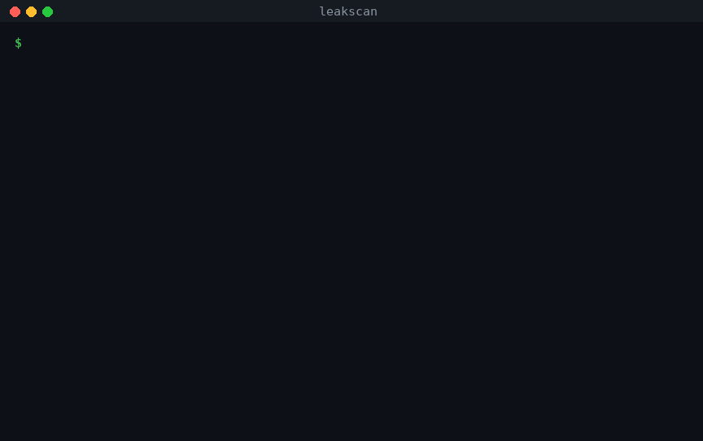

# leakscan

Find leaked API keys and secrets in your code, git history, notebooks, archives, Docker images and packages.

[](https://pypi.org/project/leakscan/)
[](https://pepy.tech/projects/leakscan)
[](https://github.com/Vasishta03/leakscan/actions/workflows/tests.yml)
[](https://codecov.io/gh/Vasishta03/leakscan)
[](https://pypi.org/project/leakscan/)
[](LICENSE)



## Quick start

```bash
pipx install leakscan        # or: pip install leakscan / brew install vasishta03/leakscan/leakscan
leakscan scan .              # scan the current project
leakscan install-hook        # block commits that contain secrets
```

Every finding tells you what the key can do if someone else has it, and where to rotate it.

## What it scans

| Target | Command |
|---|---|
| A folder or file | `leakscan scan ./src` |
| Staged changes (pre-commit) | `leakscan scan . --staged` |
| Only what a PR adds | `leakscan scan . --pr` or `--base main` or `--since-commit abc123` |
| Git history | `leakscan scan . --history --since 2024-01-01` |
| Jupyter notebooks (per cell and output) | `leakscan scan notebooks/` |
| Zip, tar, wheel and jar files | `leakscan scan . --archives` |
| stdin or a string | `cat .env \| leakscan scan -` or `leakscan scan --text "..."` |
| Any git remote (GitHub, GitLab, Bitbucket) | `leakscan scan https://gitlab.com/group/project` |
| A whole GitHub org | `leakscan scan --github-org my-org --resume org.json` |
| A Docker image, layer by layer | `leakscan scan docker://myapp:latest` |
| A published package | `leakscan scan pypi:requests==2.32.3` or `npm:left-pad@1.3.0` |
| A log as it grows | `leakscan scan app.log --follow` |

There are 208 rules, each with a stable ID like `LS-AWS-001`. They cover cloud providers, AI and ML APIs (OpenAI, Anthropic, Mistral, Groq, xAI, Hugging Face and more), payment providers, CI tokens, databases, and secrets hardcoded in Dockerfiles, Terraform, Kubernetes manifests and GitHub Actions workflows. Run `leakscan rules list` to see them all.

## Fewer false positives

- Placeholders like `EXAMPLE`, `changeme`, `xxxx`, `${VAR}` and `<your-key>` are ignored.
- GitHub tokens are checked against their built-in CRC32 checksum, card numbers against Luhn, and JWTs must decode.
- Each finding has a confidence score. It goes up near words like `secret` or `token`, and down in tests, fixtures and docs.
- To ignore one line, add `# leakscan:ignore LS-AWS-001` (or just `# leakscan:ignore`). `# nosec` and `# gitleaks:allow` also work.

## Check if a key is still live

```bash
leakscan scan . --verify
leakscan scan . --verify --verify-only github,openai --verify-timeout 3
```

This sends each key to its own provider (one read-only "who am I" style request) and marks it `active`, `inactive`, `unknown` or `error`. It supports 51 secret types. For anything you don't own (a remote repo, an org, an image or a package), you have to pass `--yes`. The [verification docs](https://vasishta03.github.io/leakscan/verification/) list exactly which URL each check calls.

## CI

GitHub Actions:

```yaml
- uses: actions/checkout@v4
  with:
    fetch-depth: 0
- uses: Vasishta03/leakscan@v1
  with:
    mode: pr          # full, pr or history
    fail-on: HIGH
    pr-comment: true
```

This uploads SARIF to code scanning and writes a job summary. Recipes for GitLab CI, Jenkins and CircleCI are in the [docs](https://vasishta03.github.io/leakscan/ci/).

pre-commit:

```yaml
repos:
  - repo: https://github.com/Vasishta03/leakscan
    rev: v0.5.2
    hooks:
      - id: leakscan
```

Output formats: `terminal`, `json` (versioned schema), `sarif`, `html`, `junit`, `markdown`, `csv`, `sonarqube`, `defectdojo`. Exit codes: `0` clean, `1` findings at or above `--fail-on` (default `HIGH`), `2` error.

## Python API

```python
import leakscan

result = leakscan.scan_path("src/")
for f in result.findings:
    print(f.rule_id, f.file, f.line_number, f.confidence)

leakscan.scan_text(open(".env").read(), filename=".env")
```

## AI coding agents

`leakscan hook` stops Claude Code or Cursor from writing a secret into a file or a shell command. `leakscan mcp` runs an MCP server so an agent can scan text or files before it commits. Setup is in the [agent docs](https://vasishta03.github.io/leakscan/agents/).

## How it compares

All three are good tools. Pick the one that fits.

| | leakscan | gitleaks | trufflehog |
|---|---|---|---|
| Install | pip, pipx, brew, Docker, binaries | Go binary, brew, Docker | Go binary, brew, Docker |
| Built-in detectors | 208 | about 200 | 800+ |
| Live key verification | 51 types, opt-in | No | Yes, most detectors |
| Staged / diff scanning | Yes | Yes (`--staged`) | Yes (`--since-commit`) |
| Archives and decoding | Yes (opt-in) | Yes | Yes |
| Docker images, GitHub orgs | Yes | No | Yes, plus S3, GCS, Postman and more |
| PyPI / npm packages | Yes | No | No |
| Notebook cell and output locations | Yes | No | No |
| Blast radius and rotation link per finding | Yes | No | No |
| Python API | Yes | Go library | No |
| SARIF | Yes | Yes | Yes |

Use **gitleaks** if raw speed matters most. In our [benchmark](benchmarks/README.md) it scanned the requests repo's full history 4.4x faster than leakscan. Use **trufflehog** if you need verification across hundreds of services or sources like S3 and Postman. leakscan is the easiest of the three to drop into a Python project or a notebook workflow.

## More

- [Docs](https://vasishta03.github.io/leakscan/): configuration (`.leakscan.yaml`, allowlists, per-directory overrides, rule packs), every CLI flag, the rule catalog, and notifications (Slack, Discord, Teams, email, webhooks)
- [Changelog](CHANGELOG.md)
- [Contributing](CONTRIBUTING.md). Adding a new rule takes about 10 minutes.
- [Security policy](SECURITY.md)

leakscan sends no telemetry. It only makes network calls when you ask for them (`--verify`, remote targets, `--notify`).

If leakscan caught something for you, a star helps other people find it.

MIT licensed.
