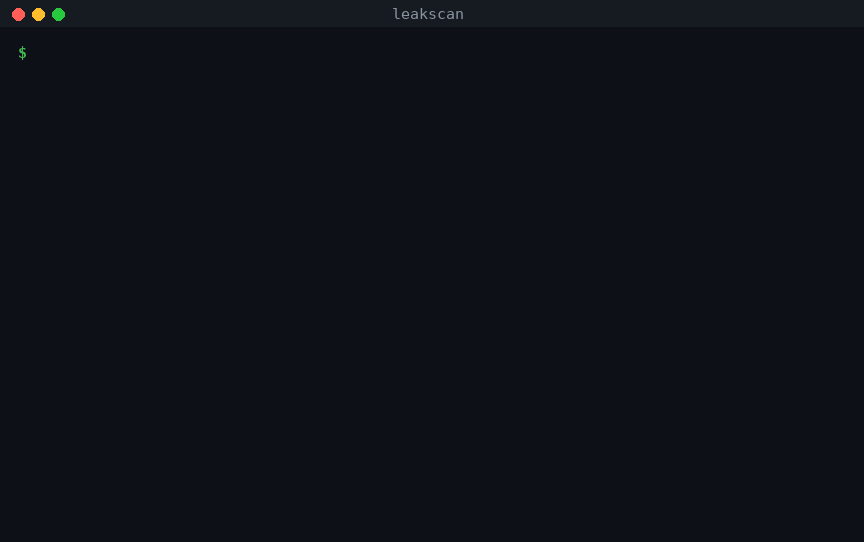

# leakscan

leakscan finds leaked API keys, tokens, passwords and private keys. It scans source trees, git history, pull request
diffs, Jupyter notebooks, archives, Docker images, PyPI and npm packages, and any git remote.

```bash
pipx install leakscan
leakscan scan .
```



Each finding shows the rule ID, how confident leakscan is, what an attacker could do with the secret, and where to
rotate it. Inside a git repo it also shows who committed it and how long it has been exposed.

- New here? Read [Install](install.md), then [Scanning](usage.md).
- Setting up CI? Go to [CI recipes](ci.md).
- Too many false positives? See [Configuration](config.md).
- Looking up a rule? Browse the [rule catalog](rules/index.md).
